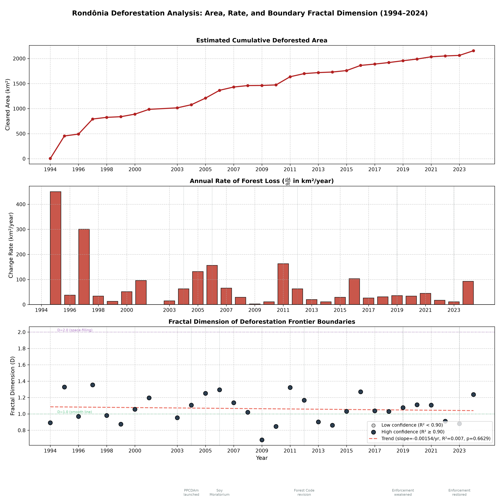
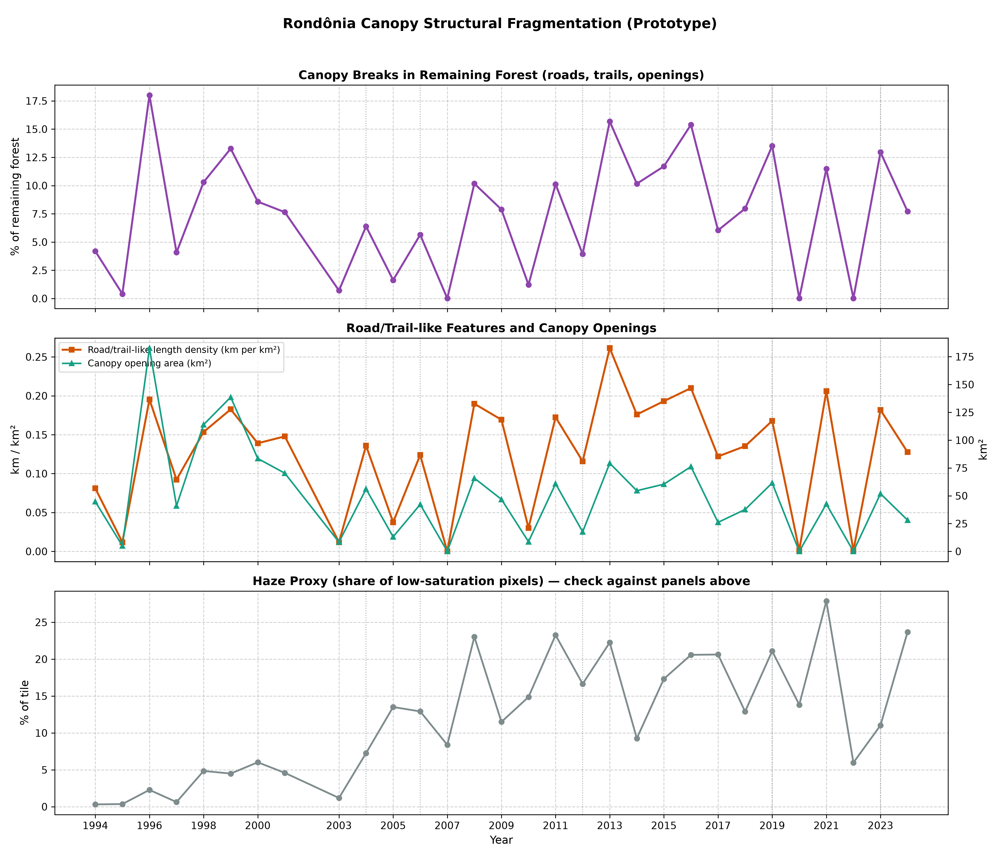

# Tracking Deforestation in Rondônia with Image Processing and Fractal Geometry

An Image & Video Processing (IVP) course project. We process 30 years of Landsat imagery (1994–2024) of a
0.5° x 0.5° tile in Rondônia, Brazil, estimate how much forest is cleared each year, and ask whether the
**geometry** of newly cleared areas (box-counting fractal dimension) changes over time. A second module looks for
**structural fragmentation** inside the remaining forest (roads, trails, canopy openings).

> Student prototype using classical image-processing methods on composited satellite images. The numbers are
> reproducible outputs of the code but are **not validated** against official deforestation data
> (see [Limitations](#5-limitations)).

## What this project shows

1. **A complete, reproducible pipeline** from Earth Engine download to segmentation, frontier extraction,
   fractal analysis, canopy-fragmentation detection, statistics and charts.
2. **No detectable trend in boundary fractal dimension** over 30 years, and no shift around the five policy years
   we examined. That is a real (null) answer to the research question for this tile and dataset.
3. **A quantified methodological finding:** the fractal dimension of a yearly change mask is driven mainly by how much
   new clearing there was (Spearman ρ = 0.96), and the segmentation settings strongly change the numbers. Both must be
   controlled before FD can be interpreted as "boundary complexity".
4. **A plausible mid-2000s peak** in annual new clearing (2005–2006) followed by lower values, which matches the
   widely reported national pattern, though it is not validated here.
5. **A diagnosed list of what limits the result** (haze, sensor changes, hue-only segmentation) and a concrete
   plan to fix it.

---

## 1. Research questions

1. How much new forest is cleared per year in the study tile, 1994–2024?
2. Does the fractal dimension (FD) of the deforestation frontier show a trend over time, or shift around known
   policy events?
3. Can edge detection and morphology find roads, trails and canopy openings inside the remaining forest?

## 2. Data

| Item | Value |
|---|---|
| Source | Landsat via Google Earth Engine (`download_dataset.py`) |
| Sensors | Landsat 5 TM (1994–2011), Landsat 7 ETM+ (2012), Landsat 8 OLI (2013–2024) |
| Product | Top-of-atmosphere (TOA) reflectance; median composite of June–October scenes with < 40% cloud |
| Tile | lon −63.5 to −63.0, lat −10.5 to −10.0 (about 3,102 km²) |
| Resolution | 30 m per pixel (1856 x 1857 px) |
| Format | 8-bit RGB GeoTIFF (`visualize(min=0.03, max=0.25)`) |
| Missing year | 2002 (skipped, never interpolated); 30 images processed |

## 3. Method

### 3.1 Deforestation segmentation (`process_amazon_timeseries.py`)

| Step | IVP concept | Detail |
|---|---|---|
| 1 | Colour-space conversion | BGR to HSV, keep the Hue channel |
| 2 | Spatial filtering | 5x5 Gaussian blur to suppress sensor noise |
| 3 | Thresholding | Otsu automatic threshold (inverse) |
| 4 | Polarity check | Invert the mask if more than half of it is white (Otsu picks a different side of the hue histogram in some years; it fired in 22 of 30 years) |
| 5 | Morphology | Erosion (1x) then dilation (2x), 5x5 kernel |
| 6 | Accumulation | Cumulative OR across years gives cleared area; pixel count x 0.0009 km² |
| 7 | Frontier | New clearing in year *t* = cumulative(*t*) AND NOT cumulative(*t*−1) |

### 3.2 Fractal dimension of the frontier

1. Canny edge detection on the frontier mask.
2. Box counting with box sizes 2, 4, 8, ..., 256 px.
3. Linear regression of log N(s) on log s; FD = −slope; R² reported per year.
4. Trend line and vertical markers for five policy events (PPCDAm 2004, Soy Moratorium 2006, Forest Code
   revision 2012, enforcement weakened 2019, enforcement restored 2023). The event list comes from the script and
   has not been independently sourced.

### 3.3 Canopy openness and logging-road detection (structural fragmentation)

Added on top of the original pipeline without changing it.

1. Restrict to standing forest: outside the cumulative cleared mask plus a 3 px buffer.
2. Normalise forest texture contrast per year (median/MAD), Gaussian blur, Canny edges.
3. Morphological closing joins nearby edges; small enclosed loops are filled; components under 100 px are dropped.
4. Each component is classified with the distance transform: width ≈ 2·max(DT) − 1, length ≈ area / width.
   Elongation (length/width) ≥ 4 and length ≥ 15 px (450 m) gives a **road/trail-like** feature; otherwise a
   **canopy opening**.
5. Per-year outputs: percentage of forest with breaks, road-like length density (km/km²), opening area, and a haze
   proxy (share of low-saturation pixels) for confound checking.

On synthetic test images the module separated 3 canopy openings from a road network correctly; isolated road
lengths were within about ±10% (branching networks were underestimated, around 60–85% of true length).

## 4. Results





### 4.1 Headline numbers (from `deforestation_results.csv`)

| Quantity | Result |
|---|---|
| Estimated cumulative cleared area, 2024 | 2,155 km² (about 69% of the tile; probably an overestimate, see Limitations) |
| Mean annual new clearing | 1996–2001 (excl. 1997): 46 · 2003–2007: 89 · 2008–2015: 41 · 2016–2024: 44 km²/yr |
| Largest annual new clearing | 1995 (450), 1997 (301), 2011 (163), 2006 (156), 2005 (132) km² |
| Fractal dimension, all years | mean 1.06, SD 0.17, range 0.68–1.35 |
| Box-counting fit quality | R² between 0.98 and 0.996 in every year |
| FD trend over time | Kendall τ = −0.03, p = 0.86; OLS slope −0.0015/yr, p = 0.66; Theil–Sen −0.001/yr (95% CI −0.009 to +0.007) |
| FD vs size of that year's new clearing | Spearman ρ = 0.96 (p < 1e-15); vs number of frontier contours ρ = 0.88 |
| Variance of FD explained by ln(frontier area) | about 90% |
| FD trend after removing the size effect | Kendall τ = 0.25, p = 0.053; OLS p = 0.23 (not significant) |
| Years with FD < 1 | 11 of 30 |
| 2003–2007 vs 2008–2024 new clearing | mean 89 vs 43 km²/yr (median 65 vs 29), Mann–Whitney p = 0.048 (window chosen after viewing the chart) |
| Annual new clearing vs haze proxy | Spearman ρ = 0.03 (no relation); FD vs haze ρ = 0.14 |
| Years where the polarity flip fired vs not | FD 1.11 vs 0.92 (p = 0.004); new clearing 88 vs 26 km² (p = 0.012); contours 1,225 vs 468 (p = 0.002) |

### 4.2 Policy-event windows (exploratory, uncorrected p-values)

Mann–Whitney U, years before vs from the event year (1994 excluded as the baseline year).

| Event | FD before / after | p (FD) | New clearing before / after (km²/yr) | p (clearing) |
|---|---|---|---|---|
| 2004 PPCDAm | 1.09 / 1.06 | 0.83 | 126 / 54 | 0.28 |
| 2006 Soy Moratorium | 1.11 / 1.05 | 0.48 | 121 / 50 | 0.094 |
| 2012 Forest Code | 1.09 / 1.05 | 0.58 | 102 / 40 | 0.15 |
| 2019 Enforcement weakened | 1.07 / 1.05 | 0.94 | 83 / 39 | 0.51 |

The 2023 event has too few later years to test. None is significant, and a multiple-comparison correction would only
make that clearer. The "before" windows include 1995 and 1997, which are likely inflated (see Limitations).

### 4.3 Canopy fragmentation module

- Runs end to end on all 30 years and writes overlays, a CSV and the chart above.
- The break fraction ranges from 0% to about 18%. Three years (2007, 2020, 2022) return zero while neighbouring
  years show 6–15%, and road-like density and opening area rise and fall together.
- Correlation of the break fraction with the haze proxy: Spearman ρ = 0.30, p = 0.11.
- These outputs are **exploratory**: they show the method runs and which parameters matter, not yet a trustworthy
  fragmentation trend.

### 4.4 What the results indicate

1. **FD shows no trend.** The frontier's fractal dimension is statistically flat over 30 years, and none of the
   policy windows shifted it. For this tile and dataset the answer is "no evidence of a trend".
2. **FD mostly reflects how much clearing happened.** Large years (1995, 1997, 2005, 2006, 2011, 2016) have FD
   ≥ 1.25; tiny years (2009: 2.3 km²) have 0.68. Values below 1 cannot describe a real 2-D boundary and appear when
   sparse patches are counted at large box sizes. A clean fit (R² ≥ 0.98 everywhere) does not guarantee a meaningful
   dimension. This is the central methodological lesson: FD of a yearly change mask has to be controlled for size.
3. **After controlling for size, FD drifts slightly upward** (later clearings a bit more irregular than their size
   predicts) but this is not significant (Kendall p = 0.053, OLS p = 0.23). It is a lead, not a result.
4. **New clearing peaks in the mid-2000s.** The highest non-artifact values are 2005–2006, and 2008–2024 is
   lower (p = 0.048, exploratory). The direction matches the widely reported fall in Amazon deforestation after
   the mid-2000s. The apparent steady decline (OLS −4.7 km²/yr, p = 0.018) is driven by 1995 and 1997; without them
   there is no trend (p ≈ 0.5).
5. **Annual new clearing and FD are not tied to haze** (ρ = 0.03 and 0.14), which is encouraging for the
   year-to-year differences. The cumulative area does correlate with haze (ρ = 0.75), largely because both rise over time.
6. **Segmentation choices change the answer.** Years where the polarity flip fired have larger frontiers and higher FD.
   Together with the diagnostic that the raw cleared fraction correlates with haze (ρ = 0.59), this quantifies how
   sensitive hue-Otsu segmentation of TOA composites is, and motivates the surface-reflectance rebuild below.

## 5. Limitations

- **TOA composites over three sensors** with a June–October window (includes burning season). Forest brightness
  shifts at the 2012 and 2013 sensor boundaries (blue median +11, then −16).
- **Hue-only segmentation is a proxy**, not NDVI. The polarity check selects the minority Otsu cluster, which is the
  soil-like tail in 8 years and the haze/shadow tail in 22. The 1994→1995 jump (0.1% → about 14.6% of the tile) and
  the 1997 spike are most likely this switching, not clearing events. Cumulative OR keeps every false positive, so
  the 2024 cumulative area is probably too high.
- **Frontier = difference of two noisy masks**, so segmentation noise can appear as new clearing.
- **Box-counting** depends on the box-size range and mixes within-patch roughness with between-patch spacing.
- **30 m resolution** misses narrow logging roads; the canopy module sees wide roads, fishbone feeder roads and
  openings of a few pixels or more. Rivers can be classified as road-like.
- **No ground truth.** Nothing is compared with INPE PRODES or MapBiomas.
- **Correlation only.** Nothing here shows that a policy caused a change. The post-hoc 2003–2007 vs 2008–2024
  comparison was chosen after looking at the data.

## 6. Future work

1. Rebuild the dataset from Landsat Collection 2 **surface reflectance** (cloud/shadow masking, one fixed season,
   harmonised sensors) and segment with NDVI/NBR.
2. Validate annual new clearing against PRODES or MapBiomas for the tile.
3. Compute FD per patch and over a restricted box range; report it alongside patch size.
4. Classify clearings (smallholder fishbone vs industrial blocks) from FD plus shape features and test whether FD
   adds information beyond area.
5. Tune and validate the canopy module on hand-labelled crops.

## 7. How to run

```bash
pip install opencv-python numpy matplotlib scipy earthengine-api geemap
earthengine authenticate
# set ee.Initialize(project=...) in download_dataset.py to your own Earth Engine project
python download_dataset.py            # creates amazon_30years_clean/rondonia_YYYY.tif
python process_amazon_timeseries.py   # segmentation, FD and canopy analysis
```

| File / folder | Content |
|---|---|
| `deforestation_results.csv` | Per-year cumulative area, rate, frontier area, FD, R², contour count |
| `combined_analysis.png` | Cumulative area, annual rate and FD trend with policy markers |
| `canopy_fragmentation_results.csv` | Per-year break fraction, road-like density, opening area, haze proxy |
| `canopy_fragmentation_trend.png` | Canopy fragmentation chart |
| `output_masks/`, `output_overlays/`, `output_frontiers/`, `output_canopy/` | Per-year masks and overlays |

Key parameters sit at the top of `process_amazon_timeseries.py` (`BOX_SIZES`, `MIN_CONTOUR_PIXELS`, morphology kernel
and iterations, `CANOPY_*` settings). There are no random components, so reruns reproduce the same outputs.

## 8. Repository layout

```
download_dataset.py            # Earth Engine export of yearly composites
process_amazon_timeseries.py   # segmentation, frontier, FD, canopy fragmentation
deforestation_results.csv
canopy_fragmentation_results.csv
combined_analysis.png
canopy_fragmentation_trend.png
```